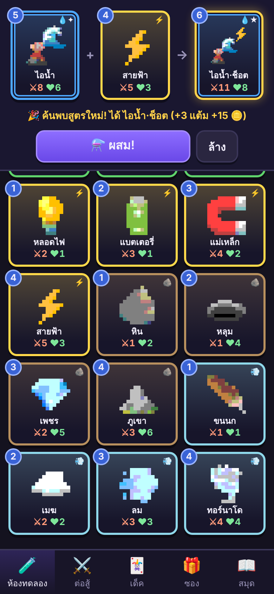
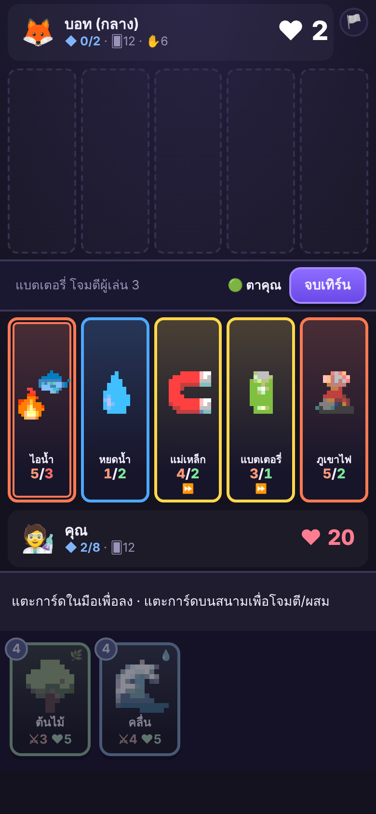
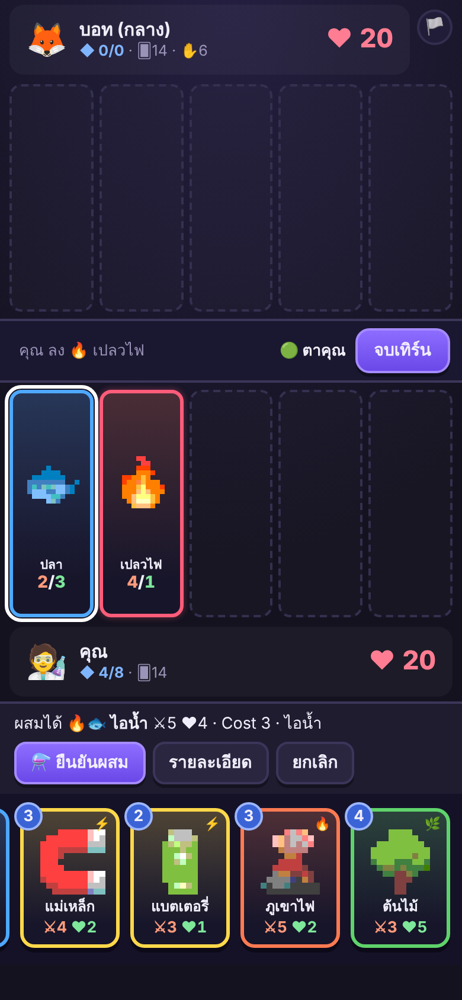

# Emoji Fusion TCG 🧪

เกมการ์ดสะสมจากอิโมจิพิกเซลอาร์ต — ผสมการ์ดสองใบเป็นใบใหม่แบบ Little Alchemy แล้วเอาไปต่อสู้แบบ TCG
เป็นเว็บล้วน (HTML/CSS/JS) ไม่ต้องติดตั้งอะไร เล่นบนมือถือได้

## ฟีเจอร์
- **ห้องทดลอง:** ผสมการ์ดได้ไม่จำกัด ค้นพบสูตรใหม่ (276 สูตรขั้น 2 + ขั้น 3 อีกมาก)
- **ต่อสู้กับบอท:** 3 ระดับ (ง่าย/กลาง/ยาก) ผสมการ์ดกลางสนามได้
- **สร้างเด็ค:** 20 ใบ ใส่ซ้ำได้ไม่เกิน 2 ใบ
- **ซองการ์ด:** ใช้เหรียญที่ได้จากการชนะและการค้นพบสูตร
- **สมุดสูตร / สมุดการ์ด:** ดูความคืบหน้า
- บันทึกอัตโนมัติใน `localStorage`

## ภาพหน้าจอ
| ห้องทดลอง | ต่อสู้ | ผสมกลางสนาม |
|---|---|---|
|  |  |  |

## ลงเว็บด้วย GitHub Pages
1. สร้าง repository ใหม่บน GitHub แล้วอัปโหลดไฟล์ทั้งหมดในโฟลเดอร์นี้ (หรือใช้ `git push` ด้านล่าง)
2. ไปที่ **Settings → Pages** เลือก Branch `main` โฟลเดอร์ `/ (root)` แล้วกด Save
3. รอสักครู่ เกมจะอยู่ที่ `https://<ชื่อผู้ใช้>.github.io/<ชื่อ repo>/`

```bash
git init
git add .
git commit -m "Emoji Fusion TCG"
git branch -M main
git remote add origin https://github.com/<ชื่อผู้ใช้>/<ชื่อ repo>.git
git push -u origin main
```

## รันในเครื่อง
ต้องเปิดผ่านเซิร์ฟเวอร์ (เพราะโหลด `cards.json` ด้วย fetch):
```bash
python3 -m http.server 8000   # แล้วเปิด http://localhost:8000
```

## โครงสร้างไฟล์
| ไฟล์ | หน้าที่ |
|---|---|
| `index.html` `style.css` `script.js` | หน้าเว็บ ระบบเด็ค ซอง ห้องทดลอง หน้าจอต่อสู้ |
| `fusion.js` | สูตรผสมการ์ด (ตัวปรับสมดุลอยู่ที่ `CONFIG`) |
| `battle.js` | เอนจินต่อสู้ + บอท (ตัวปรับกฎอยู่ที่ `RULES`) |
| `cards.json` | ข้อมูลการ์ดพื้นฐาน เวทย์ สนาม และการ์ดผสมขั้น 2 |
| `tools/gen_cards.py` | สร้าง `cards.json` + รายงานสมดุล (รันจากโฟลเดอร์หลัก: `python3 tools/gen_cards.py`) |
| `tools/test-fusion.js` | ตรวจสูตรผสมใน JS ตรงกับ `cards.json` ครบ 276 สูตร |
| `tools/simulate.js` | จำลองบอทสู้บอท ตรวจว่าเอนจินไม่พัง |
| `docs/design.md` | เอกสารออกแบบกติกาเต็ม และผลตรวจสมดุล |

## ความสามารถเฉพาะตัว (v0.4)
การ์ดพื้นฐานทั้ง 24 ใบมีความสามารถของตัวเอง (ดูตารางใน `docs/design.md` หัวข้อ 4.5) และการ์ดผสมสืบทอดต่อจากแม่ที่ Cost สูงกว่า ทดสอบด้วย `node tools/test-abilities.js`

## ทัวร์สอนเล่น
ครั้งแรกที่เปิดเกม (หลังปิดแบนเนอร์มีอะไรใหม่) จะมีทัวร์ 12 ขั้น ข้ามได้ตลอด: ผสมการ์ดในห้องทดลอง → ดูความสามารถ → แมตช์ฝึกกับบอทง่าย (ลงการ์ด → โจมตี → ผสมในสนาม → จบเทิร์น) แมตช์ฝึกให้มานา 7 ไม่นับรางวัลและสถิติ เปิดซ้ำได้ที่แท็บสมุด → 🎓 ทัวร์สอนเล่น โค้ดอยู่ใน `script.js` (`STEPS`)

## ที่ยังไม่ได้ทำ
ภาพพิกเซลวาดเอง (ตอนนี้แปลงจากอิโมจิของเครื่องอัตโนมัติ) · การ์ดตำนาน 10 ใบ · เล่นออนไลน์ · mulligan
