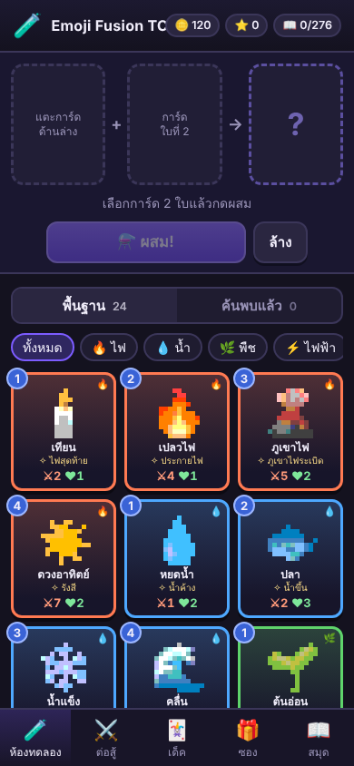
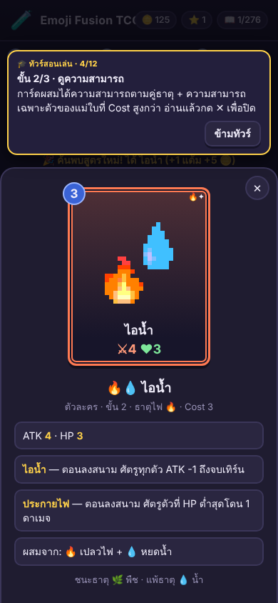
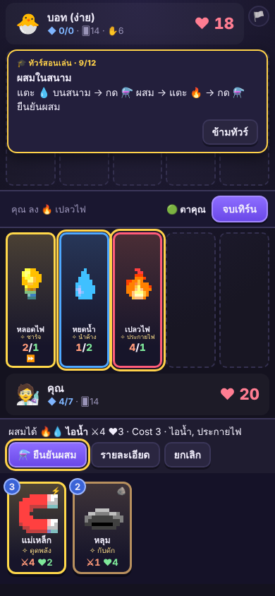
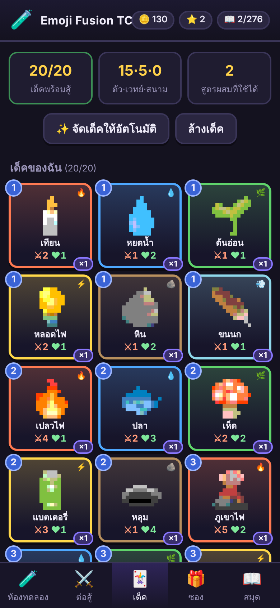
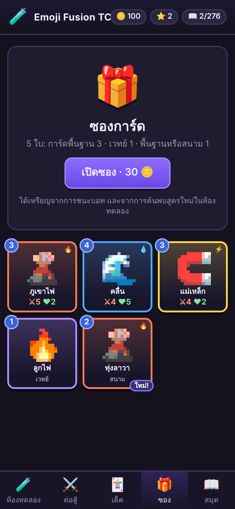
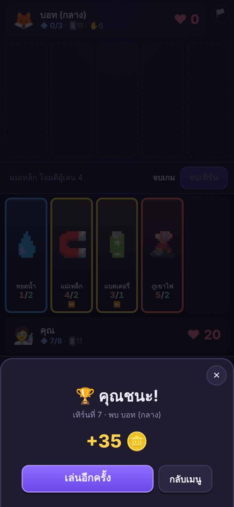

# Emoji Fusion TCG 🧪

> **ผสมอิโมจิพิกเซล 2 ใบให้เป็นการ์ดใหม่ แล้วเอาไปสู้!**
> เกมการ์ดสะสมสไตล์ Little Alchemy × TCG เล่นบนเบราว์เซอร์ ไม่ต้องติดตั้ง ไม่ต้องสมัคร เล่นบนมือถือได้

**▶ [เล่นเลย](https://solakung.github.io/emoji-fusion-tcg/)**

## เล่นยังไง (30 วินาที)
1. **ผสม** — เลือกการ์ด 2 ใบ เช่น 🔥 + 💧 แล้วกดผสม ได้การ์ดใหม่ที่มีความสามารถไม่เหมือนใคร
2. **ค้นพบ** — มี 24 การ์ดพื้นฐาน → 276 สูตรขั้น 2 → ผสมซ้อนเป็นขั้น 3 ได้อีกมาก ค้นพบสูตรใหม่ได้เหรียญ
3. **สู้** — จัดเด็ค 20 ใบ ต่อสู้กับบอท 3 ระดับ ลงการ์ด โจมตี แล้ว**ผสมกลางสนาม**ได้ ธาตุชนะทางได้ดาเมจเพิ่ม
4. **สะสม** — เปิดซองการ์ดด้วยเหรียญที่ได้จากการชนะและการค้นพบ

ครั้งแรกที่เข้า มีทัวร์สอนเล่นสั้นๆ พาทำจริงทีละขั้น (ข้ามได้)

## จุดเด่น
- **การ์ดทุกใบมีความสามารถของตัวเอง** การ์ดผสมสืบทอดความสามารถจากแม่ ผสมคู่ไหนก็ได้ของใหม่
- **ภาพพิกเซลอาร์ต** สร้างจากอิโมจิ การ์ดผสมซ้อนภาพของแม่ทั้งสอง
- **ผสมได้ทั้งในห้องทดลองและกลางสนามต่อสู้** ต้องคิดว่าจะเสียมานาผสมหรือลงการ์ดเพิ่ม
- **วงจรธาตุ 6 ธาตุ** ไฟ → พืช → ดิน → ลม → ไฟฟ้า → น้ำ → ไฟ ชนะทางได้ดาเมจ +1
- **หน้าต้อนรับครั้งแรก:** เลือก เข้าสู่ระบบ/สมัคร หรือ เล่นแบบแขก (สมัครทีหลังได้ที่ปุ่ม 👤)
- **เล่นแบบแขกได้เลย** บันทึกอัตโนมัติในเบราว์เซอร์ (`localStorage`) หรือ **สมัครบัญชี** (อีเมล) เพื่อเซฟการ์ด เหรียญ เด็ค ไว้บนคลาวด์ เล่นต่อได้ทุกเครื่อง บัญชีเก็บอีเมลกับชื่อผู้เล่นบน Firebase ดูรายละเอียดที่ `docs/online-setup.md`

## ภาพหน้าจอ
| ห้องทดลอง | ดูความสามารถ | ต่อสู้ + ผสมกลางสนาม |
|---|---|---|
|  |  |  |

| เด็ค | ซองการ์ด | ชนะ |
|---|---|---|
|  |  |  |

## ฟีเจอร์ทั้งหมด
- **ห้องทดลอง:** ผสมการ์ดได้ไม่จำกัด ค้นพบสูตรใหม่
- **ต่อสู้กับบอท:** ง่าย / กลาง / ยาก (รางวัล 20 / 35 / 60 🪙)
- **สร้างเด็ค:** 20 ใบ ใส่ซ้ำได้ไม่เกิน 2 ใบ พร้อมจัดเด็คอัตโนมัติ
- **ซองการ์ด:** 30 🪙 ต่อซอง 5 ใบ
- **สมุดสูตร / สมุดการ์ด:** ดูความคืบหน้า

## ลงเว็บด้วย GitHub Pages
1. สร้าง repository ใหม่บน GitHub แล้วอัปโหลดไฟล์ทั้งหมดในโฟลเดอร์นี้ (หรือใช้ `git push` ด้านล่าง)
2. ไปที่ **Settings → Pages** เลือก Branch `main` โฟลเดอร์ `/ (root)` แล้วกด Save
3. รอสักครู่ เกมจะอยู่ที่ `https://<ชื่อผู้ใช้>.github.io/<ชื่อ repo>/`

```bash
git init
git add .
git commit -m "Emoji Fusion TCG"
git branch -M main
git remote add origin https://github.com/<ชื่อผู้ใช้>/<ชื่อ repo>.git
git push -u origin main
```

## รันในเครื่อง
ต้องเปิดผ่านเซิร์ฟเวอร์ (เพราะโหลด `cards.json` ด้วย fetch):
```bash
python3 -m http.server 8000   # แล้วเปิด http://localhost:8000
```

## โครงสร้างไฟล์
| ไฟล์ | หน้าที่ |
|---|---|
| `index.html` `style.css` `script.js` | หน้าเว็บ ระบบเด็ค ซอง ห้องทดลอง หน้าจอต่อสู้ |
| `online.js` | ล็อกอิน เซฟบนคลาวด์ ชื่อผู้เล่น (Firebase) · กฎฐานข้อมูลอยู่ที่ `docs/firebase-rules.json` |
| `fusion.js` | สูตรผสมการ์ด (ตัวปรับสมดุลอยู่ที่ `CONFIG`) |
| `battle.js` | เอนจินต่อสู้ + บอท (ตัวปรับกฎอยู่ที่ `RULES`) |
| `cards.json` | ข้อมูลการ์ดพื้นฐาน เวทย์ สนาม และการ์ดผสมขั้น 2 |
| `tools/gen_cards.py` | สร้าง `cards.json` + รายงานสมดุล (รันจากโฟลเดอร์หลัก: `python3 tools/gen_cards.py`) |
| `tools/test-fusion.js` | ตรวจสูตรผสมใน JS ตรงกับ `cards.json` ครบ 276 สูตร |
| `tools/simulate.js` | จำลองบอทสู้บอท ตรวจว่าเอนจินไม่พัง |
| `docs/design.md` | เอกสารออกแบบกติกาเต็ม และผลตรวจสมดุล |

## ความสามารถเฉพาะตัว (v0.4)
การ์ดพื้นฐานทั้ง 24 ใบมีความสามารถของตัวเอง (ดูตารางใน `docs/design.md` หัวข้อ 4.5) และการ์ดผสมสืบทอดต่อจากแม่ที่ Cost สูงกว่า ทดสอบด้วย `node tools/test-abilities.js`

## ทัวร์สอนเล่น
ครั้งแรกที่เปิดเกม (หลังปิดแบนเนอร์มีอะไรใหม่) จะมีทัวร์ 12 ขั้น ข้ามได้ตลอด: ผสมการ์ดในห้องทดลอง → ดูความสามารถ → แมตช์ฝึกกับบอทง่าย (ลงการ์ด → โจมตี → ผสมในสนาม → จบเทิร์น) แมตช์ฝึกให้มานา 7 ไม่นับรางวัลและสถิติ เปิดซ้ำได้ที่แท็บสมุด → 🎓 ทัวร์สอนเล่น โค้ดอยู่ใน `script.js` (`STEPS`)

## ที่ยังไม่ได้ทำ
ภาพพิกเซลวาดเอง (ตอนนี้แปลงจากอิโมจิของเครื่องอัตโนมัติ) · การ์ดตำนาน 10 ใบ · เล่นออนไลน์ · mulligan
